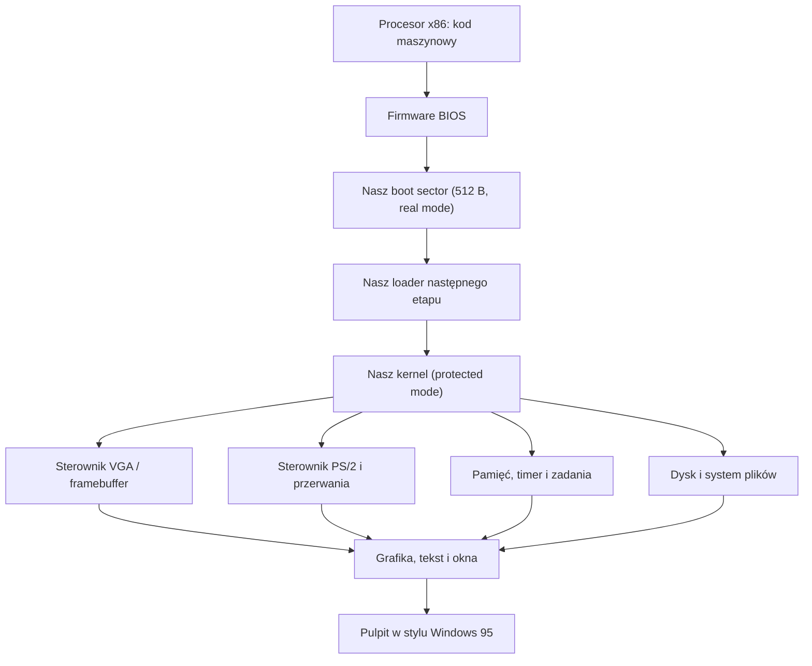

# Projekt: Własny system operacyjny od zera (x86 / bare metal)

> **Status: PLAN / SZKIC DO PRZEGLĄDU** · Utworzono 2026-11-26 · Żaden etap nie jest jeszcze zaliczony.
>
> To konspekt projektu edukacyjnego. Pełny kod systemu będzie w osobnym repozytorium, a tutaj przechowujemy mapę nauki, decyzje, wnioski i przyszłe case studies — zgodnie z [RULES.md](../../RULES.md).

## Po co to robimy?

Zrozumieć od podstaw, co dzieje się między włączeniem komputera a zobaczeniem własnego obrazu na monitorze, a następnie zbudować prosty, autorski system z interfejsem inspirowanym Windows 95.

**Zasada:** nie kopiujemy całych rozwiązań bez zrozumienia. Po każdym etapie trzeba umieć wyjaśnić, co robi każda ważna instrukcja, skąd bierze się obraz i jaka część pracy należy do firmware’u, sprzętu lub naszego kodu. AI pomaga w nauce i debugowaniu, nie zastępuje samodzielnego rozumowania.

## Granice „od zera”

- Własny kod startowy, własny bootloader i dalszy kernel, **bez Linuxa, FreeRTOS, Circle i gotowego silnika graficznego**.
- Najpierw asembler x86; później język C w środowisku **freestanding**, bez zakładania obecności funkcji systemu operacyjnego lub biblioteki standardowej.
- BIOS (firmware) komputera/maszyny wirtualnej uruchamia nasz pierwszy sektor. W pierwszych ćwiczeniach może też przygotować tryb ekranu; później będziemy konfigurację VGA poznawać i zastępować własnym kodem.
- „Bare metal” **nie** oznacza projektowania tranzystorów, procesora i firmware’u od zera. Kompilator, asembler, narzędzia do budowania i emulator są narzędziami na komputerze deweloperskim; **nie działają wewnątrz naszego systemu**.
- Główny cel to klasyczny **x86 BIOS + VGA + klawiatura PS/2**, nie nowoczesne UEFI + HDMI/USB. Docelowo zwykły monitor i fizyczna klawiatura; najpierw emulowane w QEMU, później opcjonalnie odpowiedni starszy komputer.

## Środowisko i sprzęt

- **Start:** Mac M1 + NASM (asembler) + QEMU (`qemu-system-i386`) + narzędzia do inspekcji binariów/hexdump i debugger.
- **Dlaczego QEMU:** pozwala uruchomić i zatrzymywać x86, podejrzeć rejestry/pamięć oraz korzystać z emulowanych VGA i PS/2 bez ryzyka uszkodzenia danych na fizycznym dysku. Na Apple Silicon x86 jest emulowane programowo.
- **Później:** komputer zgodny z legacy BIOS/CSM, najlepiej z VGA i PS/2; zgodność potwierdzamy przed zakupem. Samo złącze HDMI/USB nie zapewnia prostego sterownika.
- **Nie kupujemy sprzętu przed pierwszymi etapami.**

## Architektura docelowa — schemat

*To schemat nauki, nie aktualnie działająca architektura. Kolejność niektórych podsystemów może się zmienić po pierwszych eksperymentach.*

## Roadmapa — kolejność i warunki zaliczenia

### 00. Fundamenty procesora i liczb — do zrobienia
**Poznać:** bity/bajty, system binarny i szesnastkowy, kod maszynowy, adresy, rejestry, flagi, ALU, RAM, rozkaz i cykl pobierz–wykonaj, little-endian, instrukcje `mov`, `jmp`, `cmp`.

**Dowód:** samodzielnie prześledzić kilka instrukcji i powiedzieć, które rejestry oraz bajty pamięci zmieniają się po ich wykonaniu.

### 01. Narzędzia i pierwszy binarny program x86 — do zrobienia
**Poznać:** składnię NASM, plik `.asm`, asembler vs kod maszynowy, hexdump, QEMU, debugger, obrazy dysków.

**Dowód:** złożyć plik do binarki, obejrzeć jej bajty, uruchomić emulowany procesor i zobaczyć zmianę rejestru po instrukcji.

### 02. BIOS i własny boot sector — do zrobienia
**Poznać:** sekwencję startu komputera, legacy BIOS, real mode, segment:offset, adres fizyczny `0x7C00`, sygnaturę `0x55AA`, ograniczenie pierwszego sektora do 512 bajtów, ustawienie rejestrów i stosu.

**Dowód:** własny sektor bootujący przejmuje sterowanie i wykonuje nieskończoną pętlę. Wyjaśnić każdą instrukcję oraz co zrobił wcześniej BIOS.

### 03. Pierwszy znak na ekranie — do zrobienia
**Poznać:** pamięć obrazu i pojęcie VGA text mode, adres `0xB8000`, kod znaku i atrybut koloru, różnicę między pamięcią RAM a pamięcią urządzenia.

**Dowód:** własne instrukcje zapisują literę **X** do bufora tekstowego VGA i emulowany monitor ją pokazuje. Początkowo dopuszczamy tryb obrazu ustawiony przez BIOS; sprawdzamy go przed zapisem.

### 04. VGA od strony rejestrów, piksele i pierwsza grafika — do zrobienia
**Poznać:** porty I/O, instrukcje `in`/`out`, rejestry VGA, tryby ekranu, pamięć graficzna (m.in. `0xA0000` w odpowiednim trybie), kolory, współrzędne, bufor obrazu.

**Dowód:** skonfigurować obsługiwany tryb VGA z własnego kodu, ustawić piksel i narysować prostokąt oraz linię. Nie używać gotowej biblioteki rysującej.

### 05. Klawiatura PS/2 i wejście — do zrobienia
**Poznać:** kontroler PS/2/i8042, porty `0x60` i `0x64`, status kontrolera, kody naciśnięć/zwolnień (scancodes), polling, mapowanie na znaki.

**Dowód:** samodzielny kod odbiera klawisz i wyświetla jego kod lub nazwę. Rozróżnia naciśnięcie i zwolnienie. Nie używać sterownika hosta jako sterownika kernela.

### 06. Przerwania i zegar — do zrobienia
**Poznać:** tablicę wektorów w real mode oraz IDT w protected mode, IRQ, PIC 8259, PIT, procedury obsługi przerwań, bezpieczne potwierdzanie IRQ.

**Dowód:** klawiatura działa na przerwaniach, zegar zlicza tyknięcia, a nie tylko na odpytywaniu w pętli.

### 07. Loader kolejnych sektorów i 32-bit protected mode — do zrobienia
**Poznać:** odczyt sektora dysku, drugi etap bootloadera, A20, GDT, segmenty, przejście do protected mode, stos i skoki dalekie.

**Dowód:** BIOS uruchamia nasz sektor, a własny loader ładuje większy program i przekazuje do niego sterowanie w 32-bitowym trybie chronionym.

### 08. Kernel w C bez systemu — do zrobienia
**Poznać:** kompilację cross-compilerem/freestanding, ABI, linker script, układ sekcji w pamięci, współpracę C i asemblera, obsługę wyjątków.

**Dowód:** funkcja kernela w C działa bez Linuxa i bez `printf`; potrafi wywołać własny kod wypisujący znaki.

### 09. Zarządzanie pamięcią — do zrobienia
**Poznać:** mapa pamięci, sterta i stos, alokator fizycznych stron, pamięć wirtualna, paging, page fault, podstawowe struktury danych.

**Dowód:** kernel potrafi przydzielić i zwolnić pamięć oraz zgłosić błędny dostęp zamiast nieprzewidywalnie działać.

### 10. Dysk, pliki i proste programy — do zrobienia
**Poznać:** sektory, urządzenie blokowe, własny prosty system plików lub ograniczony odczyt FAT, API plikowe, ładowanie danych i programów. BIOS do odczytu tylko na wczesnym etapie; docelowo własny sterownik zgodny z emulowanym kontrolerem.

**Dowód:** zapisać/odczytać plik i wczytać dane do osobnego programu. Etap jest trudniejszy i może być realizowany później niż pierwsze GUI.

### 11. Mysz PS/2, grafika 2D i menedżer okien — do zrobienia
**Poznać:** obsługę myszy, kursor, zdarzenia, przyciski, clipping, buforowanie obrazu, bitmapowe fonty, prostą kompozycję powierzchni.

**Dowód:** na monitorze widać pulpit z dwoma oknami, które można przesuwać myszką; obsługa rysowania i wejścia jest naszego autorstwa.

### 12. Zadania, aplikacje i mini-pulpit w stylu Windows 95 — do zrobienia
**Poznać:** stany zadań, przełączanie kontekstu, scheduler, izolację i granice uprawnień (późniejszy etap), pętlę zdarzeń, API własnych programów.

**Dowód:** uruchomić przynajmniej dwie proste aplikacje (np. notatnik i kalkulator), przełączać je przez pasek zadań oraz wyjaśnić, jak kernel zarządza nimi.

### 13. Testy, dokumentacja i retrospekcja — do zrobienia
**Poznać:** debugowanie instrukcja po instrukcji, testy w emulatorze, analiza wyjątków i wycieków pamięci, protokołowanie decyzji.

**Dowód:** spisać architekturę i trudności, udokumentować każdy kamień milowy, osobno oznaczyć teorię, samodzielną implementację i praktyczne zastosowanie.

## Kamienie milowe, które chcemy zobaczyć

- [ ] **M1** — własna instrukcja zmienia wartość w rejestrze CPU.
- [ ] **M2** — BIOS startuje nasz kod z własnego sektora.
- [ ] **M3** — litera **X** na monitorze, zapisana przez nas do VGA.
- [ ] **M4** — pierwszy własny piksel i prostokąt.
- [ ] **M5** — klawisz odczytany własnym sterownikiem.
- [ ] **M6** — własne przerwania i timer.
- [ ] **M7** — loader i kernel w protected mode.
- [ ] **M8** — zarządzanie pamięcią oraz plikami.
- [ ] **M9** — mysz, okna, pulpit i własne aplikacje.

## Decyzje podjęte w rozmowie

1. Chcemy zejść **do instrukcji procesora**, a nie tworzyć tylko wygląd Windowsa 95 na gotowym systemie.
2. Potrzebny jest **normalny monitor i klawiatura**; wbudowany ekran dotykowy nie spełnia założenia.
3. Priorytetem są własne sterowniki i zrozumienie każdej warstwy, nie skróty z gotowymi frameworkami.
4. Startujemy od **x86, legacy BIOS, VGA i PS/2**, bo to czytelniejsza ścieżka edukacyjna do pierwszego znaku na monitorze niż własny sterownik HDMI i USB.
5. Pierwsze testy na **Macu M1 w QEMU**, fizyczna maszyna dopiero po sprawdzeniu wymagań.
6. Żadnych „zaliczonych” etapów bez faktycznego eksperymentu i umiejętności wyjaśnienia działania.

## Co robimy podczas pierwszej sesji?

1. Rozrysować CPU → rejestry → pamięć → instrukcje maszynowe.
2. Zrozumieć na przykładzie, jak instrukcja `mov` zmienia wartość rejestru.
3. Przygotować NASM i QEMU na Macu M1 (jeśli jeszcze nie są zainstalowane).
4. Napisać **najprostszy boot sector** i zrozumieć `BITS 16`, `ORG 0x7C00`, `jmp` oraz `0xAA55`.
5. Przejść instrukcja po instrukcji w debuggerze, bez bezmyślnego kopiowania.
6. Dopiero później zapisać znak do VGA.

## Referencje do weryfikacji podczas nauki

- [OSDev — Boot Sequence](https://wiki.osdev.org/Boot_Sequence)
- [OSDev — System Initialization (x86)](https://wiki.osdev.org/System_Initialization_%28x86%29)
- [OSDev — VGA Text Mode](https://wiki.osdev.org/VGA_Text_Mode)
- [OSDev — Bare Bones](https://wiki.osdev.org/Bare_Bones)
- [QEMU — oficjalna dokumentacja](https://www.qemu.org/docs/master/system/qemu-manpage.html)

> **Ograniczenie:** klasyczne BIOS i VGA text mode nie są uniwersalne na nowoczesnych komputerach z UEFI. Dlatego eksperymenty projektujemy najpierw dla emulowanej maszyny PC, a docelowy sprzęt zweryfikujemy osobno.
